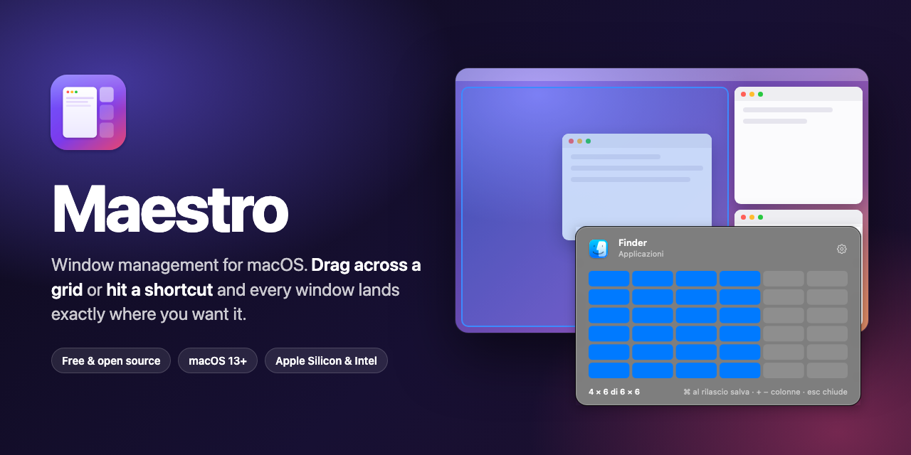
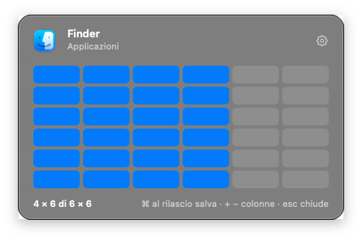
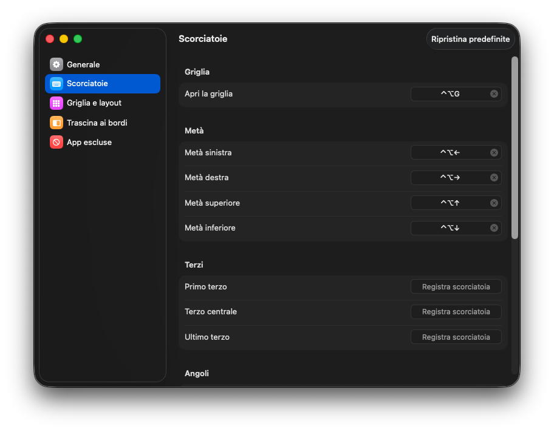
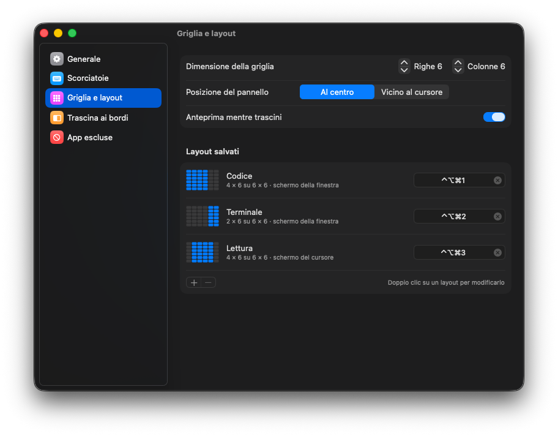
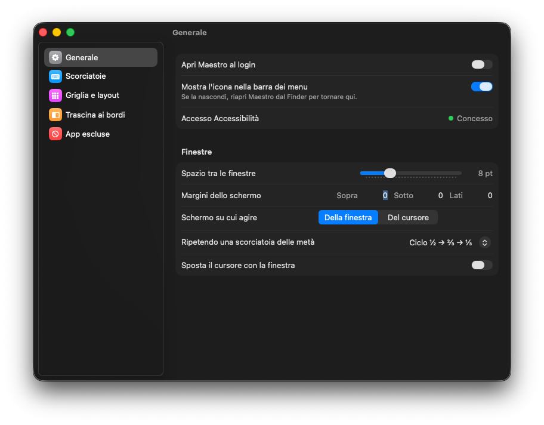
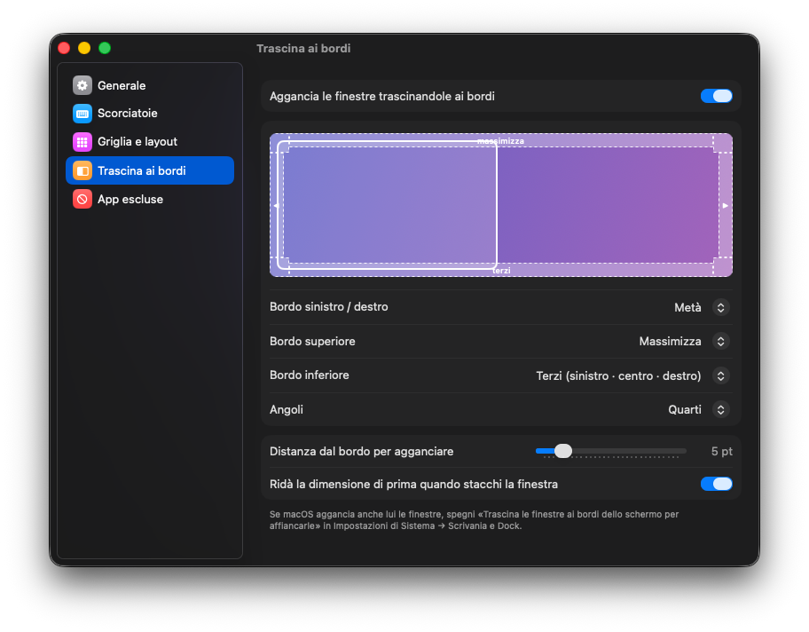

<p align="center">
  
</p>

<p align="center">
  <a href="https://github.com/Robert-Crivat/maestro/releases/latest"></a>
  
  
  <a href="LICENSE"></a>
  <a href="https://github.com/Robert-Crivat/maestro/actions/workflows/build.yml"></a>
  <!-- TODO: replace YOUR_BMC_USERNAME with your Buy Me a Coffee username -->
  <a href="https://www.buymeacoffee.com/YOUR_BMC_USERNAME"></a>
</p>

**Maestro** is a free, open-source window manager that lives in your menu bar. It brings together the two ways people like to arrange windows on a Mac:

- **a grid you drag across** to give a window any area of the screen, like Divvy;
- **keyboard shortcuts and screen-edge snapping** for halves, thirds and quarters, like Rectangle.

No account, no telemetry, no network access. It is a ~2.5 MB universal app for Apple Silicon and Intel.

## Download

1. Download **`Maestro-0.2.0.dmg`** from the [latest release](https://github.com/Robert-Crivat/maestro/releases/latest).
2. Open it and drag **Maestro** into **Applications**.
3. Open Maestro. It is not notarized by Apple yet, so the first time macOS blocks it:
   - go to **System Settings → Privacy & Security**, scroll down and click **Open Anyway**;
   - or, in Terminal: `xattr -dr com.apple.quarantine /Applications/Maestro.app`.
4. Allow **Accessibility** when asked (**System Settings → Privacy & Security → Accessibility → Maestro**). macOS requires it for any app that moves other apps' windows.

The grid icon appears in the menu bar. Press <kbd>⌃</kbd><kbd>⌥</kbd><kbd>G</kbd> on any window to try the grid.

## Features

### The grid



Press <kbd>⌃</kbd><kbd>⌥</kbd><kbd>G</kbd>, drag across the cells and release. A preview shows where the window will land before you let go.

- <kbd>+</kbd> / <kbd>−</kbd> add or remove columns while the grid is open.
- Hold <kbd>⌘</kbd> when you release to **save the area as a layout** with its own shortcut.
- <kbd>Esc</kbd> or a click outside closes it.

<br clear="right">

### Keyboard shortcuts

| Action | Default |
|---|---|
| Open the grid | <kbd>⌃</kbd><kbd>⌥</kbd><kbd>G</kbd> |
| Left / right half | <kbd>⌃</kbd><kbd>⌥</kbd><kbd>←</kbd> / <kbd>→</kbd> |
| Top / bottom half | <kbd>⌃</kbd><kbd>⌥</kbd><kbd>↑</kbd> / <kbd>↓</kbd> |
| Quarters | <kbd>⌃</kbd><kbd>⌥</kbd><kbd>U</kbd> <kbd>I</kbd> <kbd>J</kbd> <kbd>K</kbd> |
| Maximize | <kbd>⌃</kbd><kbd>⌥</kbd><kbd>↩</kbd> |
| Center | <kbd>⌃</kbd><kbd>⌥</kbd><kbd>C</kbd> |
| Restore previous size | <kbd>⌃</kbd><kbd>⌥</kbd><kbd>⌫</kbd> |
| Next / previous display | <kbd>⌃</kbd><kbd>⌥</kbd><kbd>⌘</kbd><kbd>→</kbd> / <kbd>←</kbd> |
| Thirds | not assigned, set your own |

Press a half again to cycle **½ → ⅔ → ⅓**, or switch the setting to jump to the next display instead. Every shortcut can be changed or removed.

### Drag to snap

Drag a window against a screen edge: left and right give halves, the top maximizes, the bottom splits into thirds, the corners give quarters. Drag it away again and it gets its previous size back. Each edge can be reassigned or turned off.

### And also

- **Saved layouts**: a grid area, a name, a shortcut and a target screen (the window's or the cursor's).
- **Gaps and screen margins**, applied the same way to the grid, the shortcuts and snapping.
- **Excluded apps** that Maestro leaves alone, plus a one-click *Ignore this app* in the menu.
- **Multiple displays**, launch at login, and a menu-bar icon you can hide.

## Settings

<p align="center">
  
  
</p>
<p align="center">
  
  
</p>

> The interface is currently in Italian.

## Good to know

- **Other window managers**: if Rectangle, Divvy or Magnet run at the same time with the same shortcuts, only one app gets each key. macOS does not report this, so Maestro warns you when one of them is open.
- **macOS tiling**: on macOS 15 and later, turn off *Drag windows to screen edges to tile* (System Settings → Desktop & Dock) if both Maestro and macOS snap the same window.
- **Updating**: macOS ties the Accessibility permission to the exact app build. After installing a new version, turn the Maestro switch off and on again if windows stop moving.

## Build from source

You need macOS 13 or later and the Swift toolchain (Xcode or just the Command Line Tools).

```sh
git clone https://github.com/Robert-Crivat/maestro.git
cd maestro
scripts/build-app.sh   # universal build/Maestro.app, runs the geometry self-test
scripts/make-dmg.sh    # build/Maestro-<version>.dmg
open build/Maestro.app
```

`scripts/make-icon.sh` rebuilds the icon from `assets/icon.svg` (it uses Google Chrome to render the SVG).

### Tests

- `.build/release/Maestro --selftest` checks the layout geometry.
- `open -n build/Maestro.app --args --e2e=/tmp/report.txt` runs the end-to-end test. It opens a throwaway window in a second process and drives every feature with real keyboard and mouse events: actions, shortcuts, the grid, snapping, settings, the menu. It takes about a minute, then restores your settings and writes a report. It needs the Accessibility permission, and you should not touch the Mac while it runs.

## Support

Maestro is free. If it saves you some time every day, you can buy me a coffee ☕

<!-- TODO: replace YOUR_BMC_USERNAME with your Buy Me a Coffee username -->
<a href="https://www.buymeacoffee.com/YOUR_BMC_USERNAME"></a>

Bug reports and ideas are welcome in [Issues](https://github.com/Robert-Crivat/maestro/issues).

## Acknowledgements

Maestro is inspired by [Divvy](https://mizage.com/divvy/) by Mizage and [Rectangle](https://github.com/rxhanson/Rectangle) by Ryan Hanson. It contains no code from either: everything here was written from scratch.

## License

[MIT](LICENSE) © 2026 Robert Crivat Florian
